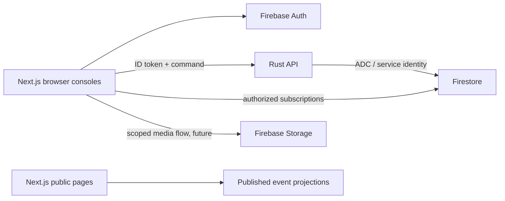

# Current architecture status — 2026-10-30

See [durable core](firestore-repositories.md) and the
[implementation audit](implementation-audit-2026-10-30.md). Rust's optional
Firestore mode now persists scoring/receipts/audits, division locks, manual
payments/reservations and membership reads. Other routes are being migrated and
return 501 in that mode. The default mode remains synthetic in-memory development.
Demo-wsb Firestore requires an explicit emulator; non-demo Firestore requires
`WSB_ENABLE_PRODUCTION_STORAGE=true`, `WSB_STORAGE=firestore`, a matching
configured project ID and ADC, and rejects an emulator endpoint. This enables
only a strict signed-identity/persistent runtime;
readiness remains 503 until the full migration and release verification are
complete. No production readiness or complete event rehearsal is claimed.
[Docker local testing](local-docker.md)
now supplies a separately compiled signed-test identity, persistent emulators,
scoped core reads and positive browser/API checks. Unsigned tokens remain rejected.

[Native registration](persistent-registration.md) and
[contact/account support](native-inquiries.md) also use transactional repositories.
Anonymous contact keys authorize only a single public inquiry; signed account
support rechecks current chapter membership. Neither path grants business authority
to support staff. Next.js renders these forms; Rust owns validation, receipts,
revision conflicts, quotas, chapter isolation and audit commits. Remaining
configuration/private-media/venue migrations keep release readiness closed.
Locked results now publish through an immutable Firestore projection; tie and
correction policies still gate those outcomes.

For chapter API sessions, Rust now verifies the Firebase ID token's signed
identity and resolves the current role from
`chapters/{chapter}/members/{uid}`. The route's chapter scope and active
membership are checked server-side; Firebase `chapterId` and `role` claims are
not authorization inputs. Each downstream durable operation rechecks the
derived role against current membership, and `auth_time` must satisfy
`valid_after`. This makes multiple chapter memberships possible without
waiting for custom-claim synchronization. The authenticated chapter selector
lists server-verified memberships at `/v1/account/chapters`; its browser-selected
chapter is routing context only. The verifier now contains a non-demo
Identity Platform check for disabled users and revoked tokens. Production
activation is explicit and remains unrehearsed; IAM setup and signed-token
validation remain release gates. See
[membership authority](persistent-membership.md).

Global HQ now has a separate signed-session gate backed by `globalMembers/{uid}`;
this does not grant chapter membership or authorize HQ actions. See
[global HQ session boundary](global-hq-session.md). Global provisioning and
audited governance actions remain unfinished.

The original foundation design below is historical context; statements that a
command/outbox does not yet exist are superseded by the audit.

---

# WSB architecture — 2026-10-29

## Selected stack

| Layer | Choice | Reason |
| --- | --- | --- |
| Web | Next.js App Router, React, TypeScript | React ecosystem plus server-rendered public event pages and isolated interactive consoles |
| API | Rust, Axum, Tokio, Tower | Typed domain boundaries, asynchronous I/O, explicit resource control |
| Database | Cloud Firestore | Firebase client subscriptions and server transactions |
| Identity / files | Firebase Auth / Storage | Existing Firebase project integration |
| Hosting target | Cloud Run API; Next.js Node hosting | Separate scaling and deployment boundaries |
| Local development | Firebase Emulator Suite, demo-wsb | Synthetic data isolated from the supplied real project |
| Offline roadmap | IndexedDB command outbox plus service-worker shell | Explicit submission acknowledgement, revisions and conflict recovery |

Next.js is selected for the mix of public event pages and private consoles. A
React/Vite SPA would be simpler for a console-only app, but would require another
approach for public server-rendered pages. No benchmark in the pasted proposal
has been established for this application. Rust does not eliminate cold starts,
network/database latency, or the need for load testing.

Initial versions are pinned in package.json and package-lock.json. The Rust
manifest uses compatible crate ranges resolved in Cargo.lock; rust-toolchain.toml
pins Rust 1.99.1 and the container builder image is pinned by digest. The community firestore
crate is an optional gRPC adapter, not an official Firebase Admin Rust SDK.

## Runtime boundaries

Next.js owns rendering, routing and browser interaction. It does not duplicate
scoring/payment business logic. Rust owns authoritative validation, tabulation,
payments, result publication and advancement. Firestore client rules deny writes
until a narrowly scoped client-owned operation is intentionally introduced.
Privileged server access bypasses rules: every repository operation must enforce
the authenticated actor's chapter and event assignment.

The initial API exposes GET /healthz and GET
/v1/chapters/{chapter_id}/session. The latter verifies RS256 signatures against
Google's keys, issuer, audience, expiry, issued-at, auth-time, subject, role and
chapter. It rejects emulator unsigned tokens. This means emulator client auth
is usable for rules tests but cannot yet authenticate to this Rust API.
There is no mutation endpoint and no claim that business authorization is done.
Add revocation/disabled-user checks and authoritative event membership lookup
before enabling sensitive commands. Current custom claims can remain stale until
token expiry. Unknown signing keys fail closed until the five-minute cache refresh.

The optional `firestore` feature initializes a client through Application Default
Credentials at startup; business repositories are not implemented. The default
API can run without credentials. `/healthz` is liveness only, not database readiness.

## Data and authority contract

- `chapters/{chapter}/members/{uid}`: server-managed roles and membership;
  current client rules allow only same-chapter self reads.
- `chapters/{chapter}/events/{event}/...`: event-local crews, assignments,
  submissions, deductions and payment ledger; denied to clients initially.
- `publicEvents/{event}`: explicit publication projection with `published=true`;
  never include private identity data or raw judge notes. Public list queries
  must filter on published; rules are not filters.
- Private identity objects and consent records: isolated from public crew data;
  retention, reviewer access and upload validation must be decided first.
- Payment amounts: integer minor units plus currency; provider event IDs are
  unique ledger keys. Replayed webhooks must produce no duplicate effects.

## PayMongo payment architecture and provider contracts

- Official Provider: PayMongo hosted checkout (`/v2/checkout_sessions`) and refunds (`/v1/refunds`). Provider payment methods are configured from the enabled account capabilities; production checkout/refund validation remains a release gate.
- Authentication: HTTP Basic Auth with `PAYMONGO_SECRET_KEY` as username and empty password.
- Server Credential Gate: Secret keys are environment-only (`PAYMONGO_SECRET_KEY`, `PAYMONGO_WEBHOOK_SECRET`). They are never stored in client documents, Firestore collections, or chapter records. Production modes fail closed (503 Service Unavailable) if credentials are missing.
- Local Testing Gate: When `WSB_LOCAL_TESTING=true` with `demo-wsb` and local Firebase emulator, the system utilizes a dedicated synthetic container on port 8191 with explicit synthetic signatures (`WSB_PAYMONGO_LOCAL_SECRET`). Synthetic emulators never call PayMongo or move money.
- Durable Reservation & Session Mapping: Before external checkout session creation, the server executes an atomic Firestore transaction (`reserve_local_checkout`) moving entry balance to `pending_minor`. On provider response, `bind_local_checkout_session` atomically writes `localCheckoutSessionIndex/{session_id}`.
- Webhook Signature Protocol: PayMongo delivers `paymongo-signature: t={ts},te={test_sig},li={live_sig}`. The server computes `HMAC-SHA256(secret, "${t}.${raw_body}")`, enforces timestamp clock skew $\le 300\text{s}$, and verifies the signature corresponding to the active mode (test or live).
- Event Deduplication & Settlement: Handlers at `/v1/paymongo/webhook` and `/v1/webhooks/paymongo` check event ID deduplication in `localCheckoutEvents/{event_id}`. Processing is an atomic transaction that moves `pending_minor` to `paid_minor`, recalculates division readiness, persists `PaymentRecord`, and writes an immutable audit log. Replayed events return 200 OK immediately without double crediting.
- Refunds & Reversals: The current finance refund route records a reasoned, idempotent full reversal for a manually reconciled payment only. It updates the WSB ledger and does not transfer money. Provider-linked refund initiation and webhook reconciliation remain disabled until controlled PayMongo validation, approved refund terms and recovery procedures are complete.

## Offline judging contract (designed, not implemented)

Each command includes operationId, event/crew scope, expectedRevision and a
versioned criteria payload. The server derives actor identity from the token.
Persist drafts/outbox locally only on a trusted device with an explicit lifecycle.
States: draft -> queued -> sending -> acknowledged, or conflict/rejected.
Never show queued data as submitted. Retry the same operationId with backoff;
the server must return the original receipt for identical retries and reject a
changed payload under the same ID. Transactions check current assignment,
division lock and expected revision before mutation, receipt and audit write.
After lock, reject queued submissions and preserve a conflict for human review.
No automatic overwrite of newer scores. Lock/finalization design must account
for transaction limits: do not aggregate an unbounded division in one transaction.

Firestore persistent cache is not enabled by default on shared devices. The
service worker and outbox will be implemented together with the first judging
slice; the present landing page is not an offline-capable PWA.

## Performance decisions

Server Components by default; Firebase only in browser modules and analytics
only after consent. Use CSS/system fonts initially. Add GSAP, Three.js or other
motion packages only per route, behind lazy loading and reduced-motion fallbacks.
Do not add Zustand until interaction profiling shows a need. Bound database
queries and live listeners; unsubscribe when routes close. CPU-heavy media work
belongs in bounded blocking workers or a separate job service, not Tokio handlers.
Choose a Cloud Run region after inspecting the actual Firestore location.

## Sources checked

- https://nextjs.org/docs/app/getting-started/server-and-client-components
- https://nextjs.org/docs/app/getting-started/installation
- https://docs.rs/axum/latest/axum/
- https://docs.rs/firestore/latest/firestore/
- https://firebase.google.com/docs/auth/admin/verify-id-tokens
- https://firebase.google.com/docs/firestore/manage-data/enable-offline

The pasted stack proposal is supporting input, not verified documentation.
