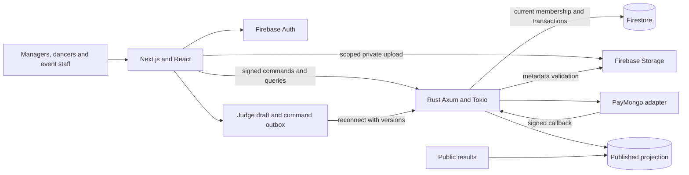
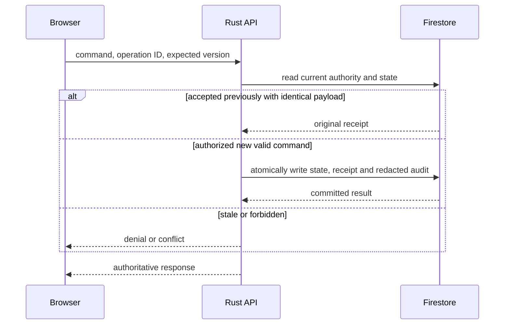

# Explanation: architecture and operating decisions

Next.js presents the public and private experiences; Rust validates authoritative business changes; Firestore stores the migrated durable workflows. The separation lets registration, money, judging and stage state share consistency rules without duplicating them in web handlers.

## Logical architecture

This is a logical diagram, not a deployed production topology. Docker substitutes Firebase emulators, a separately compiled signed local identity and a synthetic PayMongo service. The current backend explicitly restricts business persistence to `demo-wsb`.

## Shared transaction model

Network retries can repeat requests. Receipts make those retries recoverable, while revisions prevent silent overwrite. An offline judge's queue holds intent until the server checks current membership, assignment, version and lock and returns acceptance.

## Data and privacy boundaries

Chapter/event paths scope entries, payments, judge assignments, stage state and private audit. Current membership and event/stage authority are checked server-side, including replay and paginated reads. Firebase rules protect permitted client access, but privileged Rust access also needs its own authorization checks.

Private identity objects use immutable subject-owned Storage paths and are absent from published results and development retrieval. Public results use a separate immutable projection after division locking. Support access keys authorize one anonymous conversation and confer no registration, finance or judging privilege.

## ADR summary 01: retain Rust business authority

**Status:** documented existing decision, 31 October 2026. **Sources:** [workspace instructions](../../AGENTS.md), [architecture history](../architecture.md), current API repositories.

**Context:** Money reservations, roster eligibility, score locks and stage starts require shared authorization and concurrency behavior. Maintaining separate implementations in browser/web handlers risks inconsistent outcomes.

**Decision:** Keep authoritative business validation and transactions in Rust Axum/Tokio; use Next.js for routing, rendering and interaction, with Firestore as the durable database.

**Alternatives considered:** A console-only React/Vite SPA would need another public-rendering strategy; moving business logic into Next.js would conflict with the selected stack and duplicate authority. The brief's Cloud Functions proposal is historical context, not the current server implementation.

**Consequences:** One business authority supports consistent receipts and tenant isolation. Two application runtimes and a Rust Firestore adapter require operational maintenance; performance and capacity still require measurement.

## ADR summary 02: emulate PayMongo before live configuration

**Status:** user-directed local approach. **Sources:** [project context](../../memory/project.md), [payment client](../../apps/api/src/paymongo.rs), [Docker setup](../local-docker.md).

**Context:** PayMongo is the selected medium, but live credentials are unavailable. The team needs to rehearse pending/settled/cancelled state and recovery without moving money.

**Decision:** Use explicit synthetic checkout and signed emulator events locally; keep provider credentials server-only and real provider configuration separate. Accept payment only after authoritative callback reconciliation, not a browser return.

**Alternatives considered:** Pretending a button click settled payment would conceal accounting gaps. Calling another gateway would depart from the user's chosen medium; waiting for keys would prevent useful local integration work.

**Consequences:** Local testing can cover duplicate delivery, reservations and restart recovery. It cannot establish official PayMongo compatibility or live refund correctness; those need controlled provider testing and operational approval.

## ADR summary 03: publish a dedicated results projection

**Status:** implemented local boundary. **Sources:** [publication repository](../../apps/api/src/repository/publication.rs), [task scope](features.md).

**Context:** Judges need private mutable workspaces while spectators need stable authorized results. Reading private scores directly would couple provisional state and sensitive information to public pages.

**Decision:** Lock the division and publish a separate immutable result snapshot through an authorized command. Public reads use only that projection.

**Alternatives considered:** Publishing raw score documents would expose provisional state and broaden privacy risk. Browser-only ranking copies would lack an authoritative receipt and recoverable publication record.

**Consequences:** Publication has a clear audit boundary and stable public representation. Ties, approved corrections, republication and advancement remain separate policy and implementation work.

## Validation and release plan

Recorded checks cover authorization failures, cross-chapter denial, payload-bound replay, concurrent requests, lock races, outbox conflicts, scoped media rules, publication and graceful-container recovery in selected workflows. The source evidence is indexed in [feature coverage](features.md); this documentation task rechecked service health, not every historical test suite.

Before release, complete the [remaining feature scope](features.md), establish approved rules and privacy lifecycle, verify production identity/storage/provider configuration, and run a complete organizer rehearsal. Measure registration completion, reconciliation exceptions, score acknowledgement/recovery, stage conflicts and publication correctness against agreed acceptance criteria. No measured improvement percentage or capacity target is asserted today.
