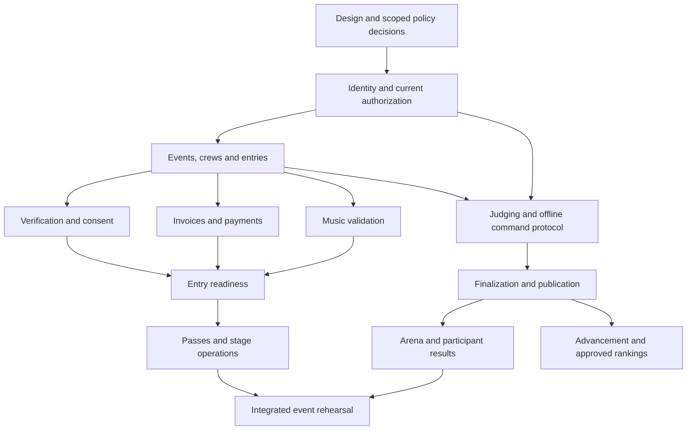

# Architecture alignment, delivery plan and acceptance gates

## Architecture boundary

Next.js owns rendering and interaction. Rust owns eligibility decisions,
permissions, payment ledger, score commands, locking, finalization and publication.
Firestore is the authoritative database. Firebase Auth identifies users; current
assignment records authorize actions. Storage holds restricted identity evidence
and media under separate policies. Public projections are purpose-built datasets
containing only approved spectator information.

Proposed route groups: `(marketing)` for public pages, `(identity)` for account
flows, `(portal)` for participant tasks, `(admin)` for chapter/HQ, `(console)` for
venue work and `(arena-live)` for display routes. These groups share tokens and
selected primitives but isolate heavy media and motion dependencies. The admin
group follows Tactical rules. Existing portal/console guidance applies equally
to private identity and administrative screens.

## Core domain records

| Domain | Main records | Authority and consistency |
|---|---|---|
| Access | users, memberships, staffAssignments, guardianRelationships | Current server lookup, validity and revocation; privacy-scoped fields |
| Organization | chapters, events, stages, divisionConfigs, ruleVersions | Used configurations versioned; chapter ownership immutable through client input |
| Registration | crews, crewMembers, entries, rosterSnapshots, invitations | Separate persistent crew identity from event roster; expiring invitations |
| Verification | verificationCases, privateEvidence, consentVersions, signatures | Minimum access, traceable review, retention workflow |
| Finance | quotes, invoices, allocations, paymentEvents, ledger, refunds | Integer minor units; currency; provider idempotency and reconciliation |
| Media | uploads, trackVersions, validationJobs, playlistManifests | Content validation, deadlines and snapshot/version checks |
| Venue | entitlements, checkIns, stageState, callHistory | Versioned commands and offline uncertainty |
| Judging | assignments, scoreRevisions, deductions, locks, commandReceipts | Actor-bound idempotency; immutable history; lock checks |
| Competition | brackets, rounds, votes, finalizationJobs, advancementInvites | Approved rules; bounded atomicity; explicit correction propagation |
| Publication | publicEvents, publicResults, publicationRevisions, certificates | Only released snapshots; retraction and supersession |
| Operations | announcements, supportCases, incidents, auditEvents, jobs | Scope, ownership, deduplication and redaction |

Exact collection layout, indexes, retention and API schema are architecture
deliverables for each slice. Do not create empty production collections merely
to match this conceptual list. Public access should not require joins into private
records. Server SDK access bypasses rules, so repository methods require explicit
tenant scope. High-volume listeners and finalization operations must fit measured
Firestore limits and anticipated event size.

## API families to specify

Identity/session and current workspaces; chapter/event administration; crew and
invitation commands; entry/readiness; verification/consent; quotes and provider
payment callbacks; upload intents/validation; entitlements/check-in; stage
transitions; score/deduction commands; match/vote control; finalization/publication;
advancement; support/audit. Define request/response errors and generated shared
types before each slice. Do not create a second authoritative implementation in
Next.js. HTTP status plus stable domain error code distinguishes unauthorized,
forbidden, validation, conflict, locked and service-unavailable conditions.

## Milestones and dependency order

| Milestone | Deliverables | Exit evidence |
|---|---|---|
| P0: product/design contract | This catalogue, role matrix, selected pilot assumptions, tokens, approved rules inventory, wireframes for key flows | Owner review of scope; unknowns recorded; route/feature coverage check |
| P1a: identity/access | Sign-in, profiles, workspace chooser, current membership lookup, staff assignments and revocation | Positive/negative tenant tests; auth action recovery; real-device sign-in |
| P1b: events/crew registration | Chapter/event discovery, event configuration, crew/invitations, draft roster and entry review | Manager-to-dancer-to-registrar journey against synthetic fixtures |
| P2a: identity and consent | Restricted evidence, reviewer queue, guardian relationship and versioned documents | Access, retention, signer and correction scenarios |
| P2b: financial readiness | Provider integration, quotes, split/bulk payment, reconciliation, refunds and receipts | Signed webhook, duplicate/out-of-order, race and refund tests |
| P2c: performance readiness | Music validation, deadline handling and track manifests | Corrupt/oversized/late files, interruption and stale exports |
| P3a: venue basics | Passes, scanner, marshal queue, communications, device setup | Camera/manual fallback, replay handling, stage conflicts and rehearsal |
| P3b: judging | Criteria controls, local outbox, submissions, deductions, review and locking | Offline/reconnect, two-device, lock race and revoked assignment tests |
| P3c: outcomes | Finalization, published scorecards, arena scenes, certificates and qualification | Snapshot validation, tie fixtures, retraction and privacy checks |
| P3d: battles if in pilot | Bracket, round/vote controller, judge voting and arena bracket | Tie/bye/withdrawal/retry and vote-window tests |
| P4: expansion | Global HQ, seasonal rankings if approved, rich editorial, studios, sponsors, native ticketing if selected | Cross-chapter operational rehearsal and content/rights approval |

Scope boundaries: merchandise fulfillment, full ecommerce, social networking,
spectator voting and advanced season ranking are optional extensions, not hidden
requirements for core crew competition. External ticket providers can cover the
pilot until native inventory/seat/ticket policies are defined. Battle scope is
required only when the pilot event includes that format. No arbitrary calendar
estimate is promised before staffing, pilot size and provider readiness are known.

## First design/implementation package

Design high-fidelity variants for home, event directory/detail, sign-in, personal
dashboard, crew roster, registration review, registrar review, judge scorecard,
head judge completion matrix, marshal queue and arena scene. Cover the states
and viewport matrix before producing every secondary screen. Approve tokens and
navigation through these representative surfaces, then reuse components across
the catalogue. Build P1a/P1b first with synthetic events and no unsourced rules.

## Verification gates

1. **Requirements:** page purpose, authorized actors, rule/source, content owner,
   dependencies and acceptance criteria are explicit.
2. **Design:** portrait/landscape, short height, 400% reflow, keyboard, focus,
   readable errors, contrast and media fallback are reviewed.
3. **Implementation:** shared contracts; chapter-scoped repositories; no sensitive
   client caches/logs; server-side business rules and idempotency.
4. **Integration:** feature-specific tests include failure and unauthorized paths;
   generated API types and versioned fixtures match actual behavior.
5. **Performance:** record bundle, web vitals, cold/warm startup, listener/read
   volume, media memory and battery behavior on pilot devices.
6. **Rehearsal:** simulate full event from invitation through publication, including
   outage, lock race, corrected result, refund and device handoff.
7. **Release:** content/media and applicable policies approved; staff trained;
   backup/restore and rollback practiced; escalation owners and monitoring ready.

A component is not complete when only its successful screenshot is polished.
Its data authority, recovery, accessibility and screen transformations must pass.
Do not mark entire roadmap phases complete because this planning library exists.

## Open decisions register

| Decision | Needed before | Proposed default while planning |
|---|---|---|
| Pilot chapter, event size, concurrent stages/judges and device inventory | Capacity plan and live release | Synthetic pilot; no invented capacity guarantee |
| Official division/rule versions and local overrides | Eligibility, scoring, advancement | Configurable rule snapshots; unverified values disabled |
| Guardian/signature, document retention and privacy policy | Collecting actual personal evidence | Minimum collection; no live documents in development |
| Supported currencies, gateways, merchant accounts and refunds | Live payment | Provider adapters behind a verified ledger contract |
| Firestore location, Cloud Run region and environment isolation | Cloud deployment | Inspect actual project before region choice |
| Staff override and separation-of-duty policy | Sensitive approvals | Explicit grants and recorded reasons |
| Live stream/media rights and brand asset variants | Public media launch | Approved stills/text only |
| Offline voting/check-in tolerance and device recovery | Live venue operation | Acknowledge uncertainty and escalate unresolved cases |
| Language/RTL and chapter localization priority | Localized launch | English source with translation-ready contracts |
| Appeal window, result visibility and judge-feedback policy | Publication | No automatic release of private critique |
| Event cancellation and transfer policy | Registration/payment launch | Explicit event policy required |
| Native ticketing/merchandise requirements | Optional commerce | Integrate approved provider where sufficient |

## Risk-based rollout

Use feature flags by environment/chapter/event. Stage public discovery, registration,
staff tools and venue features independently. Preserve previous published result
snapshots for rollback; never roll back by deleting accepted payment/score history.
PWA updates require compatible storage migrations and must not activate in the
middle of unsent judging work. Recovery runbooks cover auth outage, Firestore
latency, payment-webhook delay, device loss, corrupted track pack and publication
mistake. Operational dashboards show actionable backlog and failures without
revealing secrets or participant documents.

## Ownership and handoff

Product analyst owns acceptance/rule provenance; UI architect owns shared visual
system; frontend implementer owns responsive interaction; Rust implementer owns
authoritative commands; QA reviewer owns verification evidence; knowledge steward
maintains memory and DAG. These map to the workspace's reusable agent roles.
Parallel agents are not automatically started; assignment requires user direction
and non-overlapping file ownership under current workspace instructions.
